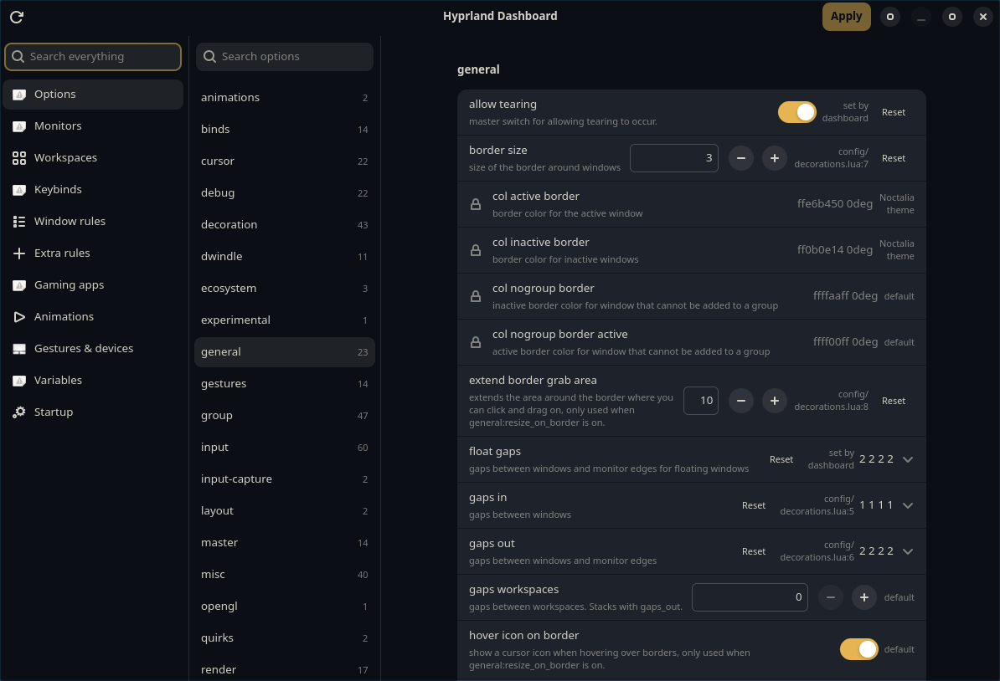

# Hyprland Dashboard

A GTK app for editing a Hyprland **Lua** config without opening the files:
options, monitors, workspaces, keybinds, window rules, animations, gestures,
per-device input, variables, environment and autostart. Every page has a
search box, and "Search everything" in the sidebar looks across all of them:
options can be changed right in the results, and clicking a result jumps to
that setting on its page and briefly highlights it.

It edits your own hand-written files in place and keeps everything else in
them (comments, layout, order) exactly as it was.



> [!WARNING]
> **Use at your own risk.** This app rewrites your Hyprland config and reloads
> Hyprland. A bad change can leave you with a broken desktop, a black screen or
> no working keyboard shortcuts, and it may only show up after you log in again.
> The backups and `restore.sh` below are there for that, but they can't cover
> everything: they only hold `~/.config/hypr` (not scripts, themes or other files
> your config uses), a backup can be older than your latest hand edits, and the
> app itself can have bugs. **Before you start, keep your own copy of your
> config somewhere else** (a dotfiles repo, or `cp -r ~/.config/hypr ~/hypr-copy`),
> and know how to reach a TTY (Ctrl+Alt+F3) to fix things. The app comes with no
> warranty (see `LICENSE`).

## Requirements

- Hyprland with a Lua config (`~/.config/hypr/hyprland.lua`). Made and tested
  on Hyprland 0.56.2. The older `hyprland.conf` format is not supported.
- Python 3.9 or newer, PyGObject, GTK 4.12+, libadwaita 1.6+
  (on Arch: `sudo pacman -S python-gobject gtk4 libadwaita`).

## Install

```sh
curl -fsSL https://raw.githubusercontent.com/Soulmanyes/hypr-dashboard/main/install.sh | sh
```

This downloads the latest release, copies the app to
`~/.local/share/hypr-dashboard` and adds "Hyprland Dashboard" to your launcher.
From a clone, `./install.sh` does the same with the code in the clone. Start the
app from inside a Hyprland session.

Installed with a version before 1.1.0? That one ran from a git clone (usually
`~/hypr-dashboard`). Run the command above once. It copies the clone's
`backups/` to `~/.local/state/hypr-dashboard/backups` and points the launcher
at the new copy. After that you can delete the clone.

## Update

When a new version is out, a bar under the title says so; press **Update**, then
**Restart**. The menu button (☰) shows the version, has **Check now**, and an
**Install updates automatically** switch (off by default). The app asks GitHub
about once a day. On the first launch after an update, it backs up
`~/.config/hypr` again.

Running the install command again also updates the app.

## While you edit

- Every row of an option shows the same value, also in Search everything.
  A typed number counts right away, without pressing Enter.
- A badge on each changed option says what Apply will do: "changed, not
  applied", "can't apply: <reason>", or "reset to default on Apply" ("reset to
  <file:line> on Apply" when one of your files also sets it). After Reset, the
  row shows the value it will get.
- "Rules for an open window…" (Window rules and Extra rules pages): pick a
  running window to see which rules match it right now and jump to one, or
  start a new Extra rule for it. Rules built in loops, or matching on things
  the app can't check (workspace, modal), are listed under "Can't tell".
  Regexes have to match the whole class or title, like in Hyprland.
- Animation styles and gesture directions and actions have a menu of the
  values Hyprland accepts; you can still type your own (`popin 70%`). Adding
  a gesture and editing one use the same fields (fingers 2 to 5).
- Text options that only take a few words (layout, accel profile, scroll
  method, the master and scrolling layout settings, `cm_sdr_eotf`) are menus
  too, and the monitor options list your connected monitors. "(not set)"
  removes the setting.
- A variable holding an installed app (`TERMINAL = "kitty"`) gets a menu of
  the other installed apps of the same kind, from their `.desktop` files
  (terminals, browsers, file managers, text editors, calculators, mail apps).
  Apps that only run inside a terminal (vim) aren't offered.
- Nested options are titled with their group ("groupbar height", "blur
  passes"), with Hyprland's description underneath.
- Apply and Refresh keep each page scrolled where it was.
- Workspaces are always picked by **number** (the one Super+1 uses), so
  rules keep working whatever a workspace is called. A **label** is only
  cosmetic: the text your bar shows instead of the number (`default_name` in
  a workspace rule). Rows read "Workspace 999 · label “gaming”". Targets you
  wrote by hand another way (`name:web`, `r[1-5]`) are shown and left alone.
- Every workspace rule shows the same fields in the same order: number,
  label, monitor, "opens first" and "kept when empty". Ones the rule doesn't
  set are empty or off; filling one in adds it, clearing it removes it. Other
  fields (gaps, borders, layout) are under "Add another field".
- A workspace rule you just added stays editable until Apply, and an
  existing rule can be moved to another number.
- A rule's label is only given when Hyprland creates the workspace. To change
  the label or number of a workspace that's open now, use **Open
  workspaces** on the Workspaces page; that happens at once and isn't saved
  in your config.

## Before you start: backups and getting back

- **On first launch**, and on the first launch after you update the app, it
  copies your whole `~/.config/hypr` into `~/.local/state/hypr-dashboard/backups`. If
  that copy fails, Apply stays off.
- **Before anything is written**, Apply lists every pending change in plain
  words ("blur enabled: off → on", "Startup command …: remove"), then every
  file it would change with the exact lines (removed in red, added in green). Nothing happens until you
  press Apply there; Cancel keeps your edits in the app.
- **Every Apply** then saves the files it is about to change in
  `~/.config/hypr/backups/hypr-dashboard-apply-<time>/` (the last 20 are kept),
  reloads Hyprland, and puts everything back by itself if Hyprland reports an
  error or a value didn't take.
- **Monitor changes** ask "Keep these display settings?" and go back after 15
  seconds unless you press Keep. That only works while the app is open.
- **If Hyprland won't start**, switch to a TTY (for example Ctrl+Alt+F3), log
  in and run:

  ```sh
  ~/.local/share/hypr-dashboard/restore.sh               # pick a backup from a list
  ~/.local/share/hypr-dashboard/restore.sh --last-apply  # or only undo the last Apply
  ```

  It asks before changing anything and first saves your current config as
  another backup, so a restore can be undone too. It needs only bash. If your
  config files are symlinks (stow and similar), a restore puts back real files
  in their place.

## What the app changes

- **Values in your files**: only plain values (`border_size = 2`,
  `"SUPER + E"`, `mainMod .. " + E"`). Anything worked out in code, built in a
  loop or inside a function is shown with a lock and left alone.
- **New entries** (binds, rules, monitors, gestures, environment variables,
  autostart commands) go right after the last one of the same kind, or at the
  end of `hyprland.lua` if you have none yet.
- **Turning off an autostart command** comments its line out with
  `-- hypr-dashboard off:` in front; turning it on removes that again.
- **Options you never set** go into `config/dashboard_options.lua`, and the app
  adds `require("config.dashboard_options")` to the end of `hyprland.lua` the
  first time.
- **Extra rules** (window rules made in the app) live in `config/dashboard.lua`
  and `config/dashboard.json`. The page offers a Connect button that adds three
  lines to the end of `hyprland.lua` so they load.
- **Gaming apps** only appears if your config already reads `gaming_apps` from
  `config/dashboard.lua`, for example:

  ```lua
  package.loaded["config.dashboard"] = nil
  local dashboard = require("config.dashboard")
  local gamingApps = "^(" .. table.concat(dashboard.gaming_apps, "|") .. ")$"
  hl.window_rule({ match = { class = gamingApps }, workspace = "10" })
  ```

**Open workspaces** (Set label now, Change number now) only send a command to the
running Hyprland; no file changes.

Colours set by a theme tool (Noctalia's `noctalia.lua`) are shown read-only.
Options set somewhere the app can't follow (a file it doesn't see, or
`hyprctl keyword`) are locked so the app never quietly overrides them.

## Uninstall

1. `~/.local/share/hypr-dashboard/install.sh --uninstall` removes the app and
   the launcher. The backups stay in `~/.local/state/hypr-dashboard/backups`.
2. If you want your config back to how it was without the app's extras, remove
   from `hyprland.lua` the `require("config.dashboard_options")` line and, if
   you pressed Connect, the three lines under
   `-- Window rules made in hypr-dashboard`, then delete
   `config/dashboard_options.lua`, `config/dashboard.lua` and
   `config/dashboard.json`. Or restore the first-launch backup with
   `restore.sh`.
3. Delete `~/.local/state/hypr-dashboard` (the backups) and
   `~/.config/hypr-dashboard` (update settings) once you no longer need them.

## License

CC0 1.0 (public domain), see `LICENSE`. It uses PyGObject, GTK and libadwaita
from your system; none of them are included here.
